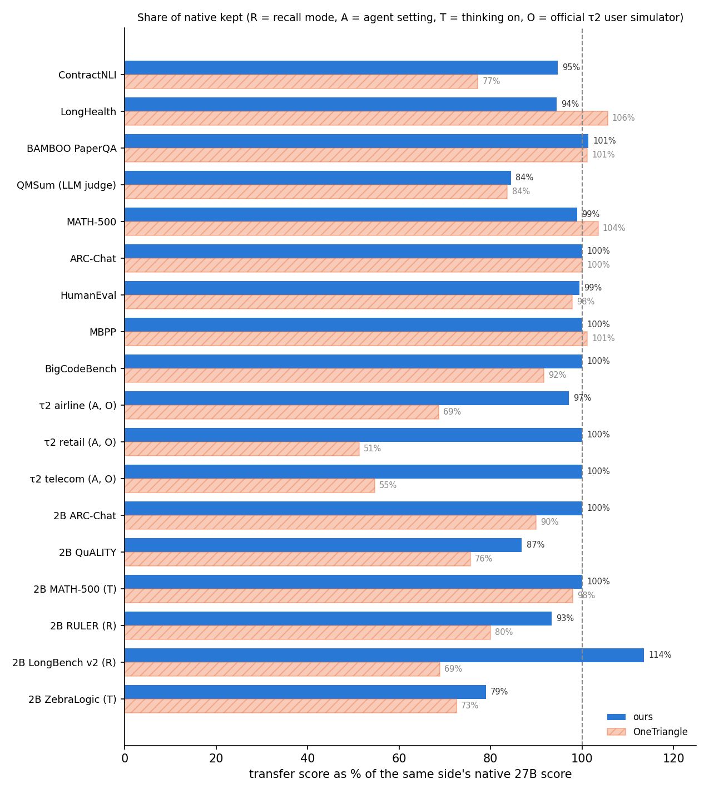

# ultra-cross-model-kv

**Prefill a 27B model with a 4B model: 2.4–3.1× faster time to first token at 8K–32K (level with OneTriangle at 8K,
ahead at 16–32K), about 2× more requests served
within a 5 s TTFT target, and no decode slowdown. Beyond 32K it is 5× faster at 128K and 21.5× at 1M, but exact
recall is not preserved there.**

`ultra-cross-model-kv` turns a Qwen3.5-4B prefill into a ready-to-decode cache for Qwen3.8-27B. It covers the
full-attention KV *and* the Gated-DeltaNet recurrent states of these hybrid models, so the 27B answers without
prefilling the prompt itself. One GPU, no cache transfer over the wire.

Comparisons are against [OneTriangle](https://onetriangle.ai/blog/transfer-benchmarks?pair=qwen-27)'s published
Qwen3.5-4B → Qwen3.8-27B results (page and data release dated 2026-11-13). Every number below comes from a file in
`results/`. Where we lose, the tables say so.

## Two modes

| | **fast mode** (default) | **recall mode** (`+repN`) |
|---|---|---|
| what the 27B computes natively | the last 128 prompt tokens (512 for prompts ≤ 4K, tapering to 128 at 8K) | the same, plus N prompt tokens picked by the source's attention from the end of the prompt: scattered 64-token blocks (`+repN`) or whole messages (`+repNm`) |
| TTFT speedup, 8K / 16K / 32K (4B → 27B) | **2.4–2.8× / 2.8–3.0× / 2.95–3.1×** | N=1024: 1.59× / 2.06× / 2.40×; N=2048: 1.37× / 1.81× / 2.17×; N=4096: 0.97× / 1.37× / 1.74× |
| TTFT speedup, 8K / 16K / 32K (2B → 27B) | 3.94× / 4.47× / 4.94× | N=2048m: 1.72× / 2.43× / 3.14×; N=3072m: 1.36× / 2.10× / 2.78× |
| use it for | everything below unless labelled | exact recall and agents |

Every quality number below names its mode. OneTriangle publishes one configuration per pair; we compare their
numbers against both of our modes and say which mode a win needs. Agent runs (τ2, Terminal-Bench) are a third configuration: the
newest turns and the tool schemas are always computed natively, and `+rep2048m` on the 4B pair was not timed, so
their TTFT is neither of the two above and was not measured.

## Scoreboard

"Ahead" means outside the noise of the two samples; "ahead within noise" means a lead that is not. n = 50–300 per
cell for most rows (Terminal-Bench: 10 tasks; OneTriangle's τ2 mapped arms: 17 per domain). Where several recall sizes or runs were tried, the cell shows the best one and says so. "Share of native" is
each side's transfer score divided by its own native 27B score under its own harness (see the chart and caveats
below the table).

| metric | ours, fast | ours, recall | OneTriangle | share of native, ours / theirs | verdict |
|---|---:|---:|---:|---:|---|
| TTFT speedup 8K / 16K / 32K | 2.4–2.8 / 2.8–3.0 / 2.95–3.1× | 0.97–2.55× (4B pair, +rep512 to +rep4096) | 2.6 / 2.7 / 2.8× | — | fast mode level at 8K, ahead at 16–32K |
| TTFT speedup 64K / 128K / 1M | 3.4–4.0 / 5.0 / 21.5× | — | 3.0 / 3.3 / 3.9×ᵃ | — | ahead (speed only, see *Beyond 32K*) |
| TPOT | = native at every batch size measured | = native | not published | — | — |
| serving goodput, TTFT ≤ 5 s | 2.2× native | not measured | not published | — | — |
| ContractNLI | **0.757** | | 0.61 | 95% / 77% | ahead (95% vs 77% of each side's native) |
| LongHealth | **0.845** | | 0.76 | 94% / 106% | ahead on score, but their mapped (0.76) beats their native (0.72): harness difference likely |
| MATH-500 | 0.89 | | 0.59 | 99% / 104% | not comparable (their native 0.57, ours 0.90) |
| BAMBOO PaperQA | 0.881 | | 0.89 | 101% / 101% | tie |
| ARC-Chat | 0.97 | | 0.97 | 100% / 100% | tie |
| HumanEval | 0.927 | | 0.91 | 99% / 98% | tie |
| MBPP | 0.875 | | 0.88 | 100% / 101% | tie |
| BigCodeBench | 0.56 | | 0.55 | 100% / 92% | tie |
| QMSum (LLM judge)ᵈ | 0.365 | | 0.41 | 84% / 84% | level as a share of native; raw scores not comparable (different judges) |
| τ2 airlineᵇ | — | 0.48 | 0.59 | 69% / 69% | level as a share of native; behind on score within noise (their n = 17) |
| τ2 retailᵇ | — | **0.78** | 0.41 | 93% / 51% | ahead |
| τ2 telecomᵇ | — | 0.10 | 0.47 | 15% / 55% | **behind** |
| 2B → 27B RULERᶜ | 0.82 | **0.905** (+rep1024) | 0.80 | 93% / 80% | tie without repair; ahead in recall (borderline, z ≈ 2; repair size tuned on RULER) |
| 2B → 27B QuALITY | **0.79** | | 0.71 | 87% / 76% | ahead within noise |
| 2B → 27B MATH-500, thinking onᵉ | 0.93 | | 0.94 | 100% / 98% | tie |
| 2B → 27B MRCR | 0.54 (held-out 0.55) | **0.681** (+rep3072m, held-out n=120; 0.706 on the dev sample) | up to 0.66ᶠ | 70% / — | ahead within noise, at 1.36× / 2.10× / 2.78× TTFT (8K / 16K / 32K) |
| 2B → 27B LongBench v2ᶜ | 0.35 | 0.42 (+rep1024; +rep2048 0.375) | 0.42 | 114% / 69% | tie in recall mode only |
| 2B → 27B ZebraLogic, thinking onᵉ | **0.75** | | 0.66 | 79% / 73% | ahead within noise (non-thinking: 0.63) |
| Terminal-Bench 2.0ᵍ | | 0.10 | 0.10 | — | level, not comparable (different 10 tasks; all of ours hit the agent time limit) |
| CowText, DevEval | not run | | published | — | not compared |

ᵃ OneTriangle's values above 64K are projections.
ᵇ Official τ2 user simulator and judges (OpenAI, as OneTriangle used), recall mode `+rep2048m` with the last three
messages and the `<tools>` block computed natively. Their mapped scores use 17 tasks per domain, ours 50. Results
with the native 27B as user simulator are in the τ2 section.
ᶜ Fixed 128-token tail rather than the adaptive one: identical to fast mode for prompts ≥ 8K, a smaller native tail
than fast mode for 4–8K prompts.
ᵈ OneTriangle scores QMSum with "the campaign's canonical judge" (an LLM). Ours is the native 27B grading each answer
0–10 against the reference (`QMSUM_JUDGE` in `src/xkv/genevals.py`), for both its own native answers and the
transfer's; their judge model is not named, so the raw
numbers are not on the same scale. With ROUGE-L instead, ours is 0.219 vs native 0.220.
ᵉ Thinking enabled for both arms (the model reasons before answering), as OneTriangle's numbers suggest they did:
their native scores 0.96 / 0.91 here, ours 0.93 / 0.95. Prompts are short (median under 2K tokens), so in fast mode
most of each prompt runs natively. Non-thinking, ours scored 0.86 on MATH-500 (phase-2 map) and 0.63 on ZebraLogic.
ᶠ OneTriangle's 0.66 is the peak of their MRCR-vs-length curve (around 16K); they do not publish a sample-wide
average or a native value at that point.
ᵍ Same recall configuration as τ2; 1 of 10 completed tasks solved (`results/terminal_bench_tb2.json`). The job stopped at its time limit with 10 of 20 tasks done, and all 10 ended at the agent's per-task time limit, so slow agent turns count against us. OneTriangle's 0.10 is also 10 tasks with an early stop (their 4B alone: 0.09). Native 27B was not run.

**Share of native, per benchmark** (transfer ÷ each side's own native; R = recall mode, T = thinking on, O = official τ2
user simulator; numbers as in the table, plus 2B ARC-Chat from the phase-2 map):



Caveats for this view: a weak native flatters the share (our 2B LongBench v2 transfer beats our own native, 114%,
which is noise); OneTriangle's shares above 100% (LongHealth, MATH-500) are harness effects; MRCR is missing because
OneTriangle publishes no native value; OneTriangle's τ2 shares divide a 17-task mapped score by a 50-task native
score; the raw scores in the table stay the primary comparison, since a share
alone would hide that our τ2 natives are weaker than theirs.

## Speed

### Time to first token (batch 1)

The comparable number is the **speedup over each side's own native baseline**; absolute times also reflect engine
and GPU differences (ours: FlashAttention-2 + fla kernels on one GPU; OneTriangle: HF forwards, 2×H100 at 32K).

| prompt | native 27B | ours, fast mode | **speedup** | OneTriangle speedup | GPU, source |
|---:|---:|---:|---:|---:|---|
| 8K | 0.90–0.93 s | 0.33–0.38 s | **2.4–2.8×** | 2.6× | H100, 6 runs⁴ |
| 16K | 1.89–1.94 s | 0.63–0.68 s | **2.8–3.0×** | 2.7× | H100, 6 runs⁴ |
| 32K | 4.14–4.25 s | 1.33–1.43 s | **2.95–3.1×** | 2.8× | H100, 6 runs⁴ |
| 64K | 9.6–10.0 s | 2.4–3.0 s | **3.4–4.0×** | 3.0× | H100 / H200, 3 runs⁵ |
| 128K | 25.5 s | 5.07 s | **5.0×** | 3.3×ᵃ | H200, median of 3 |
| 256K | 74.7 s | 10.2 s | **7.4×** | 3.6×ᵃ | H200, 1 run |
| 512K | 243.1 s | 20.3 s | **12.0×** | 3.7×ᵃ | H200, 1 run |
| **1M** | 873.2 s | 40.7 s | **21.5×** (21.1ײ) | 3.9×ᵃ | H200, 1 run |

² An earlier 1M run: native 833.2 s, ours 39.5 s (`results/ttft_h200_128k-1m_first_run.json`); its 128K point was
not warmed up and is excluded.
⁴ `results/ttft_h100_final_engine_two_runs.json`, `results/ttft_h100_8k-32k_final_engine.json` and the rep0 arms of
`results/ttft_h100_recall_mode.json`; median of 5 per run. At 8K the six runs gave 2.44×, 2.62×, 2.66×, 2.68×,
2.69× and 2.76×, so at 8K we are level with OneTriangle, not clearly ahead.
⁵ 64K does not fit next to the persistent graphed tail on an 80 GB H100 in the final build; the three measured
64K runs (`results/ttft_h100_8k-64k.json`, `results/ttft_h100_untuned_lengths_batches.json`,
`results/ttft_h200_64k-128k_reps3.json`) used earlier builds and gave 3.4×, 4.0× and 3.75×.
The 128K row is `results/ttft_h200_64k-128k_reps3.json`; the 256K–1M rows are `results/ttft_h200_128k-1m.json`
(whose own 128K point was not warmed up and is excluded). Both used an earlier engine build and the phase-2
long-context map for both arms, with the 4B on an 8K sliding window. All TTFT and TPOT runs use random token ids.

**Recall mode** (`results/ttft_h100_recall_mode.json`, H100, same native baseline):

| prompt | fast | +rep512 | +rep1024 | +rep2048 | +rep4096 |
|---:|---:|---:|---:|---:|---:|
| 8K | 2.62–2.68× | 1.72× | 1.59× | 1.37× | 0.97× |
| 16K | 2.83–2.86× | 2.19× | 2.06× | 1.81× | 1.37× |
| 32K | 2.95–2.98× | 2.55× | 2.40× | 2.17× | 1.74× |

2B → 27B with whole-message repair (`ttft_repair-H100-20261118-130157` in the same file; random ids with a
message-start token every 400 tokens, so selection sees chat-like structure):

| prompt | fast | +rep2048 | +rep2048m | +rep3072m |
|---:|---:|---:|---:|---:|
| 8K | 3.94× | 1.64× | 1.72× | 1.36× |
| 16K | 4.47× | 2.36× | 2.43× | 2.10× |
| 32K | 4.94× | 3.07× | 3.14× | 2.78× |

Recall mode on the 4B pair is **slower than OneTriangle's transfer** at every length we measured. The timed region includes
everything a request pays: the 4B pass over the native tail, the scoring pass, and the 27B forward over the chosen
tokens. One run (median of 5) per size.

**Short prompts.** In fast mode prompts under 4K get a 512-token native tail, and prompts shorter than that run
fully native (no speedup, native quality). OneTriangle does not publish TTFT below 8K.

**Shapes not used for tuning** (`results/ttft_h100_untuned_lengths_batches.json`, `results/ttft_h100_final_engine_two_runs.json`):
12K 2.6×, 24K 3.0×, 40K 3.5×; batch 2 at 16K 2.6×, at 32K 3.2×; batch 3 at 16K 3.2×. An earlier build gave
batch 2/3/4 at 8K 3.0×/3.1×/3.2× and 50K 3.7×. Batch 8 at 8K did not fit in 80 GB for the native arm.

### Decode (TPOT)

The transferred cache has the native cache's exact shape, so decoding costs the same as native at every batch size
measured (1, 2, 3, 4, 8, 12, 16, 32 at 2K; 1–12 at 32K; H200, CUDA graphs; `results/tpot_and_batch_sweeps.json`).
Recall mode writes into the same cache, so its decode cost is the same by construction; we did not measure it
separately. Optionally the 4B drafts tokens for the 27B to
verify (this needs the full 4B cache, `keep_src=True`, which adds the 4B's remaining layers and tail to the prefill):

| context | batch | native TPOT | ours | ours + 4B drafting |
|---:|---:|---:|---:|---:|
| 2K | 1 | 23.6 ms | 23.5 ms | 17.4 ms |
| 32K | 1 | 24.1 ms | 24.1 ms | 22.2 ms |
| 2K | 2 | 24.5 ms | 24.5 ms | 25.2 ms |
| 2K | 32 | 33.4 ms | 33.4 ms | 60.5 ms |

Drafting helps only at batch 1 (one prompt, 128 tokens per cell). Verification is greedy, but batched bf16 numerics
differ from step-by-step decoding: on 6 real prompts at batch 1, 4 produced a different continuation than plain
decoding (`results/spec_decode_row_independence.json`) — the same kind of divergence plain decoding shows between
batch sizes. OneTriangle publishes no TPOT for this pair.

### Serving under load (fast mode)

One H200, Poisson arrivals, prompts drawn from {8K, 16K, 32K}, 256 output tokens each, identical FCFS scheduler for
both arms, one seed, 30 requests per rate (`results/serve_h200_8k-32k.json`, 8 slots, and
`results/serve_h200_8k-32k_slots16_chunked.json`, 16 slots with chunked prefill):

| | native 27B (best of both schedulers) | ours (8 slots) | gain |
|---|---:|---:|---:|
| max throughput | 0.36 req/s | 0.45 req/s | 1.26× |
| best goodput, TTFT ≤ 5 s | 0.17 req/s | 0.37 req/s | 2.2× |
| best goodput, TTFT ≤ 2 s | 0.10 req/s | 0.20 req/s | 2.1× |
| TTFT p50 at 0.2 / 0.3 req/s | 2.0 / 5.2 s | 1.4 / 1.4 s | 1.5× / 3.6× |
| end-to-end p50 at 0.3 req/s | 27.4 s | 14.1 s | 1.9× |
| peak memory (ours incl. the 4B) | 101 GB | 96 GB | |

Throughput gains much less than TTFT because the 256-token decode, identical for both arms, dominates once prefill
is cheap. With 30 requests per point the p99 values in the result files are close to the maximum and the curves are
noisy. These runs used the phase-2 map; serving in recall mode was not measured.

## Quality

Native Qwen3.8-27B under our harness is the reference. Same prompts, greedy decoding, thinking off, for every arm.
Unless marked otherwise the transfer uses the fidelity maps (`4b-27b-fid` + `4b-27b-fid-attn`, or the 2B
equivalents) and, up to 32K, full attention in the source.

### OneTriangle's 4B → 27B suite (fast mode)

| benchmark | n | native 27B | ours (95% CI) | 128-token tail only | 4B alone | OneTriangle mapped (native) |
|---|---:|---:|---:|---:|---:|---:|
| ContractNLI | 300 | 0.80 | **0.757** (0.71–0.80) | | 0.73 | 0.61 (0.79) |
| LongHealth | 200 | 0.895 | **0.845** (0.79–0.89) | | 0.84 | 0.76 (0.72) |
| BAMBOO PaperQA | 84 | 0.869 | 0.881 (0.80–0.93) | | 0.893 | 0.89 (0.88) |
| QMSum (LLM judge) | 100 | 0.432 | 0.365 | | — | 0.41 (0.49)³ |
| QMSum (ROUGE-L) | 100 | 0.220 | 0.219 | | 0.203 | — |
| MATH-500 | 200 | 0.900 | **0.89** | 0.885 | 0.88 | 0.59 (0.57) |
| ARC-Chat | 300 | 0.97 | 0.97 | | 0.91 | 0.97 (0.97) |
| HumanEval | 164 | 0.933 | 0.927 (0.88–0.96) | 0.927 | — | 0.91 (0.93) |
| MBPP | 257 | 0.875 | 0.875 (0.83–0.91) | 0.848 | 0.80 | 0.88 (0.87) |
| BigCodeBench | 100 | 0.56 | 0.56 | 0.52 | 0.40 | 0.55 (0.60) |
| CowText | — | — | not run (not public) | | — | 0.65 (0.64) |

`results/quality_4b_fid.json` (fidelity map); native and 4B-alone columns from `results/quality_4b_suite.json`.
The HumanEval, MBPP, BigCodeBench and MATH-500 fidelity-map rows come from job logs: the job hit its time limit
before writing its result file, and the per-benchmark lines were copied from the log.
³ OneTriangle scores QMSum with an LLM judge; so does our first QMSum row (native 27B as judge, scale 0–10). As a
share of native both sides keep 84%. ROUGE-L, which barely moves, hides that loss.

- **Ahead:** ContractNLI (prompts 0.4–8K tokens, median 2K, so about three quarters of a median prompt is mapped)
  and LongHealth (longer documents). LongHealth's lead partly reflects harness differences: OneTriangle's mapped
  score is above their native one.
- **Level:** everything else that both sides ran. MATH-500's large lead reflects harness differences, not transfer
  quality: our native 27B scores 0.90 where theirs scores 0.57.
- **Short prompts are mostly native.** ARC, HumanEval, MBPP, BigCodeBench and MATH-500 prompts have a median of
  70–170 tokens, so in fast mode they run fully or almost fully native. The "128-token tail only" column shows the
  same map with the plain 128-token tail; with a 16-token tail (phase-2 map) ARC drops to 0.92, HumanEval to 0.81
  and MBPP to 0.67.
- **Losses vs native:** 4–5 points on LongHealth and ContractNLI, where the transfer is roughly level with the 4B alone.

### Agents (τ2-bench, text, English)

**With the official user simulator and judges** (OpenAI `gpt-5.5` as the simulated customer, as in the τ2 release;
OneTriangle also used the official setup):

| domain | native 27B | ours, recall `+rep2048m` | OneTriangle mapped (native) |
|---|---:|---:|---:|
| airline | 0.70 | 0.48 | 0.59 (0.86) |
| retail | 0.84 | **0.78** | 0.41 (0.80) |
| telecom | 0.68 | 0.10 | 0.47 (0.86) |

**With the native 27B as user simulator and judge** (no API needed; earlier runs):

| domain | native 27B | ours, no repair | recall `+rep2048` (blocks) | recall `+rep2048m` | mostly native⁶ |
|---|---:|---:|---:|---:|---:|
| airline | 0.74 | 0.26 | 0.60⁷ | 0.60 | 0.35 |
| retail | 0.78 | 0.60 | 0.70 | 0.735 | 0.74 |
| telecom | 0.60 | not run | 0.18 | 0.32 (`+rep4096m`: 0.20) | not run |

`results/tau2_fid.json`. Every transfer arm reads the newest turn (up to 4096 tokens) and the `<tools>` block
natively; the `+rep2048m` arms read the last three messages natively. Everything else (system policy, earlier
turns) is mapped. n = 50 tasks per domain for our arms, so ±0.13 is a 95% interval; OneTriangle's mapped arms use
17 tasks per domain (±0.23). The native airline/retail run with the 27B simulator comes from a job log.
⁶ Only the system prompt and first user turn are mapped; every later turn is appended natively to the kept cache,
so most of each conversation is computed by the 27B. Shown for completeness; not a transfer result.
⁷ Two runs with 1024 block-repair tokens gave 0.40 and 0.32.

- **Retail is a clear win** with the official simulator (0.78 vs 0.41; 93% of native vs 51%); with the 27B
  simulator it keeps a similar share (0.735 of 0.78, n = 49 with one errored task excluded).
- **Airline is level as a share of native** (69% vs 69%) but behind on score, because our native 27B scores lower
  than theirs with the official simulator (0.70 vs 0.86).
- **Telecom is a clear loss.** In most failed conversations the transferred agent, given a phone number, calls
  `get_details_by_id` instead of `get_customer_by_phone` and repeats the failing call until the error limit, or
  calls tools that only the simulated user has. The native 27B calls `get_customer_by_phone` first in 48 of 50 conversations (50 of 50 with the official
  simulator; `results/tau2_telecom_failure_analysis.json`).
  The rule that separates the two lives in the domain policy (about 23K characters), which is mapped; repair did not fix it (0.10–0.32
  across runs and simulators).

Terminal-Bench 2.0 (Harbor, Terminus-2 agent, official task containers): 0.10 in recall mode, 1 of the 10 tasks that
completed before the job's time limit (all 10 ended at the agent's per-task time limit); OneTriangle 0.10 on 10
tasks. Native 27B was not run, so there is no share of native for this row.

### OneTriangle's 2B → 27B tab

With a Qwen3.5-2B source, prompts up to 32K (`results/quality_2b_fid.json`; native and 2B-alone columns from
`results/quality_2b_suite.json`):

| benchmark | n | native 27B | ours, no repair | ours, recall | 2B alone | OneTriangle (native) |
|---|---:|---:|---:|---:|---:|---:|
| ARC-Chat⁸ | 100 | 0.98 | **0.98** | | 0.81 | 0.89 (0.99) |
| QuALITY | 100 | 0.91 | **0.79** | | 0.70 | 0.71 (0.94) |
| MATH-500⁸ | 100 | 0.87 | 0.86 | | 0.77 | |
| MATH-500, thinking on | 100 | 0.93 | 0.93 | | | 0.94 (0.96) |
| RULER 4–16K | 90 | 0.97 | 0.82 | **0.905** (+rep1024) | 0.92 | 0.80 (1.00) retrieval |
| MRCR 4–32K, dev | 60 | 0.97 | 0.52 (adaptive tail 0.54) | 0.706 (+rep3072m), 0.642 (+rep2048m), 0.522 (+rep1024m); unit cap 0.9: 0.658 (+rep2560m), 0.602 (+rep3072m), 0.564 (+rep1024m); blocks: 0.50 (+rep1024), 0.40 (+rep2048), 0.62 (+rep4096) | 0.87 | up to 0.66 |
| MRCR 4–32K, held-out | 120 | 0.972 | 0.552 (adaptive tail) | **0.681** (+rep3072m), 0.602 (+rep2048m) | 0.931 | |
| LongBench v2 (≤32K) | 200 | 0.37 | 0.35 (n=60) | 0.42 (+rep1024), 0.375 (+rep2048) | 0.23 (n=60) | 0.42 (0.61) |
| LoCoMo (F1) | 100 | 0.58 | 0.457 | | 0.39 | per-category only |
| ZebraLogic | 100 | 0.69 | 0.63 | 0.61 (+rep2048) | 0.33 | |
| ZebraLogic, thinking on | 100 | 0.95 | **0.75** | | | 0.66 (0.91), reasoning on |

⁸ Phase-2 map `2b-27b-chat`; not re-run with the fidelity map.

RULER, MRCR, LongBench v2 and LoCoMo "no repair" cells use a fixed 128-token tail (see footnote ᶜ of the scoreboard). On MRCR the native, 2B-alone, adaptive-tail (0.54), +rep2048 and +rep4096 arms were re-run on the identical 60-item sample as the no-repair arm (native 0.970, 2B alone 0.872, matching the values shown); the +rep1024 value comes from a different 60-item sample.

**MRCR needed whole-message repair.** With scattered 64-token blocks, small repair budgets scored *below* no
repair (0.40 at +rep2048 vs 0.54): the target got fragments of several candidate answers. Re-encoding whole messages
(a matching request together with the answer that follows it) fixed that. Sizes were compared on the 60-item dev
sample, where results move by about ±0.05 between neighbouring settings (a looser unit cap gave 0.602 at
+rep3072m); +rep3072m with the default cap was then fixed and run once on 120 further items never used for tuning the repair
(the fidelity maps were selected on earlier MRCR subsets, which are not guaranteed disjoint)
(`offset` 60): 0.681, with native and the 2B alone re-run on the same items. That is ahead of OneTriangle's best
bucket within noise, at 1.36× (8K), 2.10× (16K) and 2.78× (32K) TTFT for this pair. LongBench v2 is a tie only with the better of the two repair sizes we ran on the 200-item sample (0.42 vs 0.375; earlier 60-item runs with +rep1024 gave 0.38–0.42), and it is above our native 27B (0.37), which says more about the noise of this benchmark than about the transfer. ZebraLogic and MATH-500 were re-run with thinking on for
both arms, as OneTriangle's native scores (0.91, 0.96) imply they did; non-thinking, our native scores 0.69 and 0.87.
DevEval was not run (needs the repository test environments).

### Held-out fidelity gate

The fidelity maps, adaptive tail and repair were developed while looking at the benchmarks above (see *How the
evaluation was run*). To check that this did not just fit those benchmarks, we compared the phase-2 map and the
fidelity map on data neither was selected on (`results/heldout_fidelity_gate.json`, 4B → 27B):

| | native 27B | phase-2 map | fidelity map | 4B alone |
|---|---:|---:|---:|---:|
| FineWeb-Edu held-out, next-token agreement (4K prefix, 1-token tail) | 1 | 0.896 | 0.900 | 0.736 |
| same, KL to native (nats/token) | 0 | 0.059 | 0.057 | 0.367 |
| same, 128-token tail: agreement / KL | 1 / 0 | 0.925 / 0.031 | 0.925 / 0.030 | |
| HellaSwag (length-normalized acc) | 0.837 | 0.787 | 0.78 | 0.73 |
| PIQA (acc) | 0.803 | 0.803 | 0.797 | 0.797 |
| ARC-Challenge (acc) | 0.543 | 0.507 | 0.527 | 0.517 |
| MMLU (acc) | 0.853 | 0.687 | 0.673 | 0.74 |
| Winogrande (acc) | 0.76 | 0.747 | 0.75 | 0.743 |

Multiple choice: 300 items each, log-likelihood scoring, 1-token native tail (the question is almost fully mapped).

- The fidelity map is **within noise (±0.02) of the phase-2 map** on every row: slightly better on FineWeb, ARC and
  Winogrande, slightly worse on HellaSwag, PIQA and MMLU. The gains on the targeted benchmarks did not cost general
  fidelity.
- FineWeb-Edu is also part of the distillation data; this is its held-out split, i.e. unseen text from the training
  distribution. The multiple-choice sets were never used for training or selection.
- **MMLU with an almost fully mapped prompt is worse than the 4B alone** (0.67–0.69 vs 0.74). In fast mode such
  short prompts run natively, so this does not show up in the tables above, but it is a real weakness of the maps
  on short, knowledge-heavy contexts.

### Beyond 32K

Above 32K the 4B switches to an 8K sliding window, which is what makes 64K–1M fast. On RULER and MRCR at 40–64K
(4B → 27B, phase-2 map, `results/quality_64k_ruler_mrcr.json`):

| | native 27B | ours |
|---|---:|---:|
| RULER (n=27) | 0.92 | 0.55 |
| MRCR, 2 needles (n=30) | 1.00 | 0.15 |

**Exact recall degrades sharply in the long-context configuration.** The speedups above 32K should be read as speed
results only; we have not validated quality there.

### Where recall is lost

Swapping the native 27B's attention KV into a transferred cache restores exact recall (4B → 27B, phase-2 map
`4b-27b-chat`, prompts up to 64K: RULER 0.72 → 1.00, n=27; MRCR 0.30 → 0.97, n=30); swapping in the native DeltaNet
states does not (0.69, 0.26). On 2B ZebraLogic (40 puzzles) the attention swap gives 0.125 → 0.65 vs 0.225 for the
DeltaNet swap, but a plain 512-token native tail also reaches 0.65 there, so for short puzzles a longer tail is an
equally good fix (it is what the adaptive tail does). `results/oracle_diagnosis.json`. This is why the fidelity maps add a dedicated attention-KV
map and why recall mode re-encodes attention KV only.

## How it works

Qwen3.5 and Qwen3.8 are hybrid models. Three of every four layers are Gated DeltaNet (a linear-attention RNN with a
128×128 state per head); the fourth is gated full attention. Most of their "cache" is recurrent state, so a KV-only
transfer cannot work. We synthesize every piece the 27B needs:

1. **Source prefill.** The 4B runs over the prompt. We read only its normalized residual stream.
2. **Per-layer maps.** For each 27B layer, a linear map from a depth-matched 4B layer predicts what that layer caches:
   - *attention layers:* per-token `k` (post-norm, pre-RoPE) and `v`, predicted from several 4B layers plus the
     token embedding (`src/xkv/attnmap.py`); the 27B's own RoPE is applied afterwards.
   - *DeltaNet layers:* the raw `k`, `v` projections and the gate inputs `a`, `b`, which then run through **the
     27B's own** causal conv and gated delta-rule scan to give the recurrent state the 27B expects.
3. **Native tail.** The 27B natively runs the last prompt tokens on the synthesized cache and emits the first token:
   512 tokens for prompts ≤ 4K, tapering linearly to 128 at ≥ 8K. Optional *native spans* let the 27B compute
   selected regions in place (used for tool schemas and the newest agent turn).
4. **Recall mode (`+repN`).** The source reads the tail over its own cache; each 64-token block of the mapped prefix is
   scored by the source's attention from the tail (max over tail queries, summed over heads and over the 4B attention
   layers up to the deepest mapped one, first 4 positions excluded). The 27B re-encodes the top-N tokens natively in
   one batched pass (absolute-position causal attention over the full cache; each contiguous span's DeltaNet scan
   starts from the mapped end-of-prefix state, via variable-length kernels). Only the attention KV it writes is kept.
   With `+repNm` the unit is a whole chat message instead of a block: a message scores its best block, selecting it
   also takes the message that follows (a request and its answer), messages longer than N/2 (a long system prompt)
   fall back to blocks, and units are taken greedily by score until N tokens are used.
5. **Fit, then distill.** Maps start as closed-form ridge regressions on 1M calibration tokens, then are fine-tuned
   end to end on KL(native 27B ‖ transferred 27B) with gradients through the frozen 27B. Distillation data: FineWeb-Edu
   text, synthetic record lookups (close in style to needle-in-a-haystack tests), synthetic tool-use dialogues, and
   public instruction data (LongAlign-10k, Tulu-3 SFT). These were not decontaminated against the evaluation sets.

**Engine.** Fused Triton causal-conv kernel, state-only delta-rule scan, a CUDA-graphed persistent tail (prompts
≤32K), CUDA-graph batched decoding with per-sequence lengths, and source-drafted speculative decoding with exact
recurrent-state rollback (rejected tokens re-scanned with β = 0, g = 0). fla's norm kernels re-autotune for every new
sequence length; we freeze those keys, which made generation evals about 4× faster.

## How the evaluation was run, and what to be careful about

- **Configuration was chosen on evaluation items.** Full 4B attention up to 32K, the chat-distilled map and the
  free-form code prompt were adopted after trying them on LongHealth, ContractNLI and HumanEval items that are also
  in the final samples. The fidelity maps were selected on RULER, MRCR and ZebraLogic subsets; the adaptive tail on
  ZebraLogic and MBPP; recall mode and its size on 2B RULER/MRCR/LongBench v2 and τ2 airline/retail/telecom. Treat all of
  those numbers as development-set results. The held-out gate above is the guard against general regression, and
  the MRCR recall result is also reported on a held-out sample.
- **Mixed configurations.** The scoreboard takes each benchmark from the mode named in its column. No single
  configuration wins everywhere: recall mode buys τ2 retail, RULER and MRCR at the cost of TTFT.
- **Harness.** Every benchmark was reimplemented (`src/xkv/genevals.py`); OneTriangle's prompts and scorers are not
  public. Code benchmarks use a free-form "answer in a code block" prompt (a forced code prefix cost the native 27B
  6 points on HumanEval); MBPP shows its test asserts in the prompt, as is standard; MATH-500 allows 3072 new tokens
  (8192 with thinking on; ZebraLogic 12288). Thinking is off unless a row says otherwise.
- **Greedy continuations diverge.** Next-token agreement with native is 90–93% teacher-forced, but free-running greedy
  outputs drift apart early. Task scores are the meaningful measure.
- **Parity.** The engine's parity check against Hugging Face (99.6% top-1, `results/selftest_parity.json`) was run
  on the 0.8B → 2B pair, not on the 27B.
- **Timing.** The transfer reuses a preallocated graphed tail; the native path allocates its cache inside the timed
  region (well under 20 ms). Both arms run on the same engine and GPU.
- bf16 throughout, both models; no quantization on either side. Sample sizes are mostly 50–300 (Terminal-Bench 10, the 64K tables 27–30); differences of 2–3 points
  (13 on τ2) are within noise.

## Layout

```
src/xkv/qwen35.py       hybrid forward: chunked prefill, capture hooks, ring cache, scattered-position re-encode
src/xkv/mapper.py       ridge statistics, per-layer maps, transfer prefill (native spans, adaptive tail, repair)
src/xkv/attnmap.py      multi-layer + embedding attention-KV maps
src/xkv/decode.py       batched graphed decoding, speculative drafting, tail engine
src/xkv/kernels.py      fused causal depthwise conv + SiLU (Triton)
src/xkv/genevals.py     generation benchmarks (ARC-Chat … MRCR) and their scorers
src/xkv/genrun.py       batched generation for native / transfer / source arms
src/xkv/agentbench.py   OpenAI-compatible local server; tau2-bench and Terminal-Bench drivers
src/xkv/perf.py         TTFT / TPOT / serving benchmarks and profiling
src/xkv/experiments.py  selftest, calibrate, distill, quality, longctx, bench
modal_jobs/             Modal images and entrypoints
results/                outputs of the runs quoted above
```

## Reproduce

From `modal_jobs/` with `PYTHONPATH=../src`:

```bash
modal run lab.py --task ttft_repair --gpu H100 --args '{"repairs":[0,1024,2048]}'
modal run lab.py --task ttft_repair --gpu H100 --args '{"src":"2b","mapper_name":"2b-27b-fid+2b-27b-fid-attn","repairs":[0,2048,"2048m","3072m"],"msg_every":400}'
modal run lab.py --task decode_bench --gpu H200 --args '{"lengths":[2048,32768],"batches":[1,2,3,4,8,12,16,32]}'
modal run lab.py --task serve --gpu H200 --args '{}'
modal run lab.py --task gen_evals --gpu H200 --args '{"mapper_name":"4b-27b-fid+4b-27b-fid-attn","full_until":32768,"benches":["contract_nli","longhealth"],"strategies":["target","transfer@auto"]}'
modal run lab.py --task gen_evals --gpu H200 --args '{"src":"2b","mapper_name":"2b-27b-fid+2b-27b-fid-attn","full_until":32768,"max_ctx":32768,"benches":["ruler","mrcr"],"strategies":["transfer@auto","transfer@auto+rep1024"]}'
modal run agent_lab.py --task tau2 --gpu H200 --args '{"mapper_name":"4b-27b-fid+4b-27b-fid-attn","full_until":32768,"strategies":["transfer+rep2048"],"domains":["airline"],"turn_tail_max":4096,"native_tools":true}'
modal run agent_lab.py --task tau2 --gpu H200 --args '{"mapper_name":"4b-27b-fid+4b-27b-fid-attn","full_until":32768,"strategies":["transfer+rep2048m"],"domains":["airline","retail","telecom"],"turn_tail_max":4096,"turn_tail_msgs":3,"native_tools":true,"local_user_and_judges":false}'
modal run agent_lab.py --task terminal_bench --gpu H200 --args '{"mapper_name":"4b-27b-fid+4b-27b-fid-attn","full_until":32768,"strategies":["transfer+rep2048m"],"n_tasks":20,"turn_tail_max":4096,"turn_tail_msgs":3}'
modal run lab.py --task gen_evals --gpu H200 --args '{"src":"2b","mapper_name":"2b-27b-fid+2b-27b-fid-attn","full_until":32768,"max_ctx":32768,"benches":["mrcr"],"strategies":["transfer@auto+rep3072m"],"limits":{"mrcr":120},"bench_kw":{"mrcr":{"min_ctx":4096,"batch":4,"offset":60}}}'
modal run lab.py --task quality --gpu H100 --args '{"mapper_name":"4b-27b-fid+4b-27b-fid-attn","n_seqs":32,"prefix":4096,"tails":[1,128],"mc_limit":300,"mc_tails":[1]}'
```

The official τ2 user simulator and Terminal-Bench need the Modal secrets `xkv-openai` (`OPENAI_API_KEY`) and
`xkv-harbor-modal` (a Modal token for the task sandboxes). Thinking-on rows use `"env":{"XKV_THINKING":"1"}`, the
QMSum judge `"env":{"XKV_QMSUM_JUDGE":"1"}`. Code benchmarks use `"env":{"XKV_CODE_PROMPT":"free"}`; BigCodeBench executes in the official evaluation image
(`modal deploy exec_app.py`, then `"exec_modal":true`).
