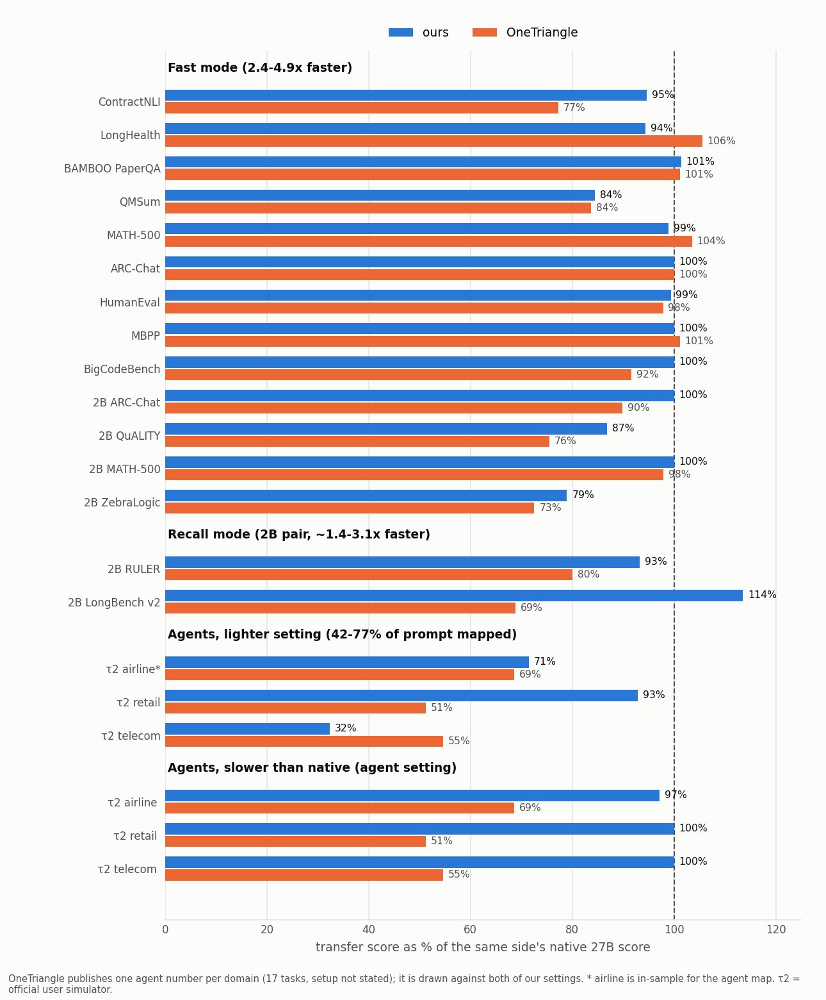
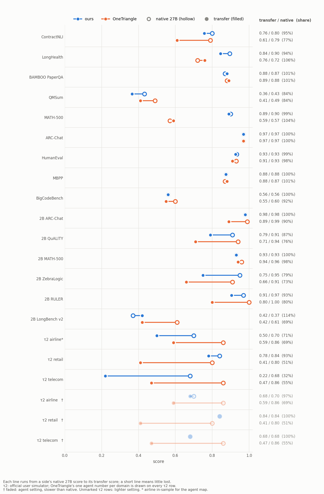

# Benchmarks

Quality results against native Qwen3.8-27B and against
[OneTriangle](https://onetriangle.ai/blog/transfer-benchmarks?pair=qwen-27)'s published Qwen3.5-4B → Qwen3.8-27B and
2B → 27B results (data release 2026-11-13). Agents (τ2, Terminal-Bench) are in [agents.md](agents.md); speed in
[speed.md](speed.md); terms in [method.md](method.md#glossary). Every number comes from a file in
[`results/`](../results/README.md).

**Reading the tables**

- Quality numbers are transfer scores unless labelled native.
- **Share of native** = transfer score ÷ the same side's native score under its own harness. It cancels harness
  differences but flatters a side whose native is weak; raw scores stay in the tables.
- Every number names its mode: *fast* (default) or *recall* (`+repN`).
- Noise: most cells are 50–300 items (±0.06–0.13 at 95%). "Within noise" means the lead is smaller than that.

## Scoreboard

| benchmark | ours, fast | ours, recall | OneTriangle | share of native, ours / theirs | verdict |
|---|---:|---:|---:|---:|---|
| ContractNLI | **0.757** | | 0.61 | 95% / 77% | ahead |
| LongHealth | **0.845** | | 0.76 | 94% / 106% | ahead on score [1] |
| MATH-500 | 0.89 | | 0.59 | 99% / 104% | not comparable [2] |
| BAMBOO PaperQA | 0.881 | | 0.89 | 101% / 101% | tie |
| ARC-Chat | 0.97 | | 0.97 | 100% / 100% | tie |
| HumanEval | 0.927 | | 0.91 | 99% / 98% | tie |
| MBPP | 0.875 | | 0.88 | 100% / 101% | tie |
| BigCodeBench | 0.56 | | 0.55 | 100% / 92% | tie |
| QMSum (LLM judge) [3] | 0.365 | | 0.41 | 84% / 84% | level as a share; raw not comparable |
| 2B → 27B RULER [4] | 0.82 | **0.905** (+rep1024) | 0.80 | 93% / 80% | tie fast; ahead in recall, borderline [5] |
| 2B → 27B QuALITY | **0.79** | | 0.71 | 87% / 76% | ahead within noise |
| 2B → 27B MATH-500, thinking [6] | 0.93 | | 0.94 | 100% / 98% | tie |
| 2B → 27B MRCR [7] | 0.54 (held-out 0.55) | **0.681** (+rep3072m, held-out) | up to 0.66 | 70% / — | ahead within noise (recall) |
| 2B → 27B LongBench v2 [4] | 0.35 | 0.42 (+rep1024) | 0.42 | 114% / 69% | tie in recall only |
| 2B → 27B ZebraLogic, thinking [6] | **0.75** | | 0.66 | 79% / 73% | ahead within noise |
| τ2, Terminal-Bench | | | | | see [agents.md](agents.md) |
| CowText, DevEval | not run | | published | — | not compared |

- **[1]** Their mapped score (0.76) beats their native (0.72): likely a harness difference.
- **[2]** Their native scores 0.57, ours 0.90.
- **[3]** OneTriangle uses an unnamed LLM judge. Ours is the native 27B grading 0–10 against the reference
  (`QMSUM_JUDGE` in `src/xkv/genevals.py`) for both arms, so raw scores are on different scales. ROUGE-L (ours 0.219
  vs native 0.220) barely moves and hides the loss.
- **[4]** Fixed 128-token tail instead of the adaptive one: same as fast mode at ≥ 8K, a smaller tail for 4–8K.
- **[5]** z ≈ 2; the repair size was tuned on RULER.
- **[6]** Thinking on for both arms, as OneTriangle's natives (0.96 / 0.91) suggest; ours 0.93 / 0.95. Prompts are
  short (median < 2K), so most of each runs natively. Non-thinking: MATH-500 0.86 (phase-2 map), ZebraLogic 0.63.
- **[7]** OneTriangle's 0.66 is the peak of their MRCR-vs-length curve (~16K), with no sample-wide average or native
  value.

Raw scores: each line runs from a side's native score (hollow) to its transfer score (filled).

Caveats: a weak native flatters the share (our 2B LongBench v2 at 114% is noise); OneTriangle's shares above 100%
(LongHealth, MATH-500) are harness effects; MRCR is missing because OneTriangle publishes no native value;
OneTriangle's τ2 shares divide a 17-task mapped score by a 50-task native one.

## 4B → 27B suite (fast mode)

Greedy decoding, thinking off. Fidelity maps (`4b-27b-fid` + `4b-27b-fid-attn`), full 4B attention up to 32K.

| benchmark | n | native 27B | ours (95% CI) | 128-token tail only | 4B alone | OneTriangle mapped (native) |
|---|---:|---:|---:|---:|---:|---:|
| ContractNLI | 300 | 0.80 | **0.757** (0.71–0.80) | | 0.73 | 0.61 (0.79) |
| LongHealth | 200 | 0.895 | **0.845** (0.79–0.89) | | 0.84 | 0.76 (0.72) |
| BAMBOO PaperQA | 84 | 0.869 | 0.881 (0.80–0.93) | | 0.893 | 0.89 (0.88) |
| QMSum (LLM judge) | 100 | 0.432 | 0.365 | | — | 0.41 (0.49) |
| QMSum (ROUGE-L) | 100 | 0.220 | 0.219 | | 0.203 | — |
| MATH-500 | 200 | 0.900 | **0.89** | 0.885 | 0.88 | 0.59 (0.57) |
| ARC-Chat | 300 | 0.97 | 0.97 | | 0.91 | 0.97 (0.97) |
| HumanEval | 164 | 0.933 | 0.927 (0.88–0.96) | 0.927 | — | 0.91 (0.93) |
| MBPP | 257 | 0.875 | 0.875 (0.83–0.91) | 0.848 | 0.80 | 0.88 (0.87) |
| BigCodeBench | 100 | 0.56 | 0.56 | 0.52 | 0.40 | 0.55 (0.60) |
| CowText | — | — | not run (not public) | | — | 0.65 (0.64) |

`quality_4b_fid.json`; native and 4B-alone from `quality_4b_suite.json`. HumanEval, MBPP, BigCodeBench and MATH-500
fidelity-map rows were copied from job logs (the job hit its time limit before writing its result file).

- **Ahead:** ContractNLI (median 2K-token prompt, ~3/4 mapped) and LongHealth (longer documents; partly harness,
  since OneTriangle's mapped beats their native).
- **Short prompts are mostly native.** ARC, HumanEval, MBPP, BigCodeBench and MATH-500 have median prompts of 70–170
  tokens, so fast mode runs them (almost) fully native. With a 16-token tail (phase-2 map) ARC drops to 0.92,
  HumanEval 0.81, MBPP 0.67.
- **Losses vs native:** 4–5 points on LongHealth and ContractNLI, roughly level with the 4B alone.

## 2B → 27B tab

Qwen3.5-2B source, prompts up to 32K (`quality_2b_fid.json`; native and 2B-alone from `quality_2b_suite.json`).

| benchmark | n | native 27B | ours, no repair | ours, recall | 2B alone | OneTriangle (native) |
|---|---:|---:|---:|---:|---:|---:|
| ARC-Chat | 100 | 0.98 | **0.98** | | 0.81 | 0.89 (0.99) |
| QuALITY | 100 | 0.91 | **0.79** | | 0.70 | 0.71 (0.94) |
| MATH-500 | 100 | 0.87 | 0.87 | | 0.77 | |
| MATH-500, thinking | 100 | 0.93 | 0.93 | | | 0.94 (0.96) |
| RULER 4–16K | 90 | 0.97 | 0.82 | **0.905** (+rep1024) | 0.92 | 0.80 (1.00) retrieval |
| MRCR 4–32K, dev | 60 | 0.97 | 0.52 (adaptive tail 0.54) | 0.706 (+rep3072m) | 0.87 | up to 0.66 |
| MRCR 4–32K, held-out | 120 | 0.972 | 0.552 (adaptive tail) | **0.681** (+rep3072m), 0.602 (+rep2048m) | 0.931 | |
| LongBench v2 (≤32K) | 200 | 0.37 | 0.35 (n=60) | 0.42 (+rep1024), 0.375 (+rep2048) | 0.23 (n=60) | 0.42 (0.61) |
| LoCoMo (F1) | 100 | 0.58 | 0.457 | | 0.39 | per-category only |
| ZebraLogic | 100 | 0.69 | 0.63 | 0.61 (+rep2048) | 0.33 | |
| ZebraLogic, thinking | 100 | 0.95 | **0.75** | | | 0.66 (0.91) |

ARC-Chat and MATH-500 were re-run with the fidelity map alongside native (the phase-2 map gave 0.98 and 0.86; the
2B-alone column is from the phase-2 run). RULER, MRCR, LongBench v2 and LoCoMo "no repair" cells use a fixed
128-token tail. DevEval was not run (needs the repository test environments).

### MRCR repair sweep (dev, 60 items)

Unit cap = the longest message, as a fraction of N, kept whole (default 0.5; longer ones fall back to blocks).

| size | unit | unit cap | score |
|---|---|---|---:|
| +rep1024m | message | default | 0.522 |
| +rep2048m | message | default | 0.642 |
| +rep3072m | message | default | **0.706** |
| +rep1024m | message | 0.9 | 0.564 |
| +rep2560m | message | 0.9 | 0.658 |
| +rep3072m | message | 0.9 | 0.602 |
| +rep1024 | block | — | 0.50 |
| +rep2048 | block | — | 0.40 |
| +rep4096 | block | — | 0.62 |

All arms except block +rep1024 (different 60-item sample) ran on the same 60 items as no-repair.

- **Why whole messages.** Scattered 64-token blocks scored *below* no repair at small budgets (0.40 vs 0.54): the
  target got fragments of several candidate answers. Re-encoding a request together with its answer fixed that.
- **Held-out run.** +rep3072m was fixed on dev (neighbouring settings move ±0.05), then run once on 120 unseen items
  (`offset` 60): 0.681, with native and 2B alone re-run on the same items. The fidelity maps were selected on earlier
  MRCR subsets, not guaranteed disjoint from these. TTFT cost: 1.36× / 2.10× / 2.78× at 8K / 16K / 32K.
- **LongBench v2** ties only with the better of two repair sizes (0.42 vs 0.375; earlier 60-item runs gave
  0.38–0.42), and it is above our own native (0.37), which says more about benchmark noise than transfer quality.

## Held-out fidelity gate

The maps, adaptive tail and repair were developed while looking at the benchmarks above. To check for overfitting,
the maps were compared on data none was selected on (`heldout_fidelity_gate.json`, 4B → 27B):

| | native 27B | phase-2 map | fidelity map | agent map | 4B alone |
|---|---:|---:|---:|---:|---:|
| FineWeb-Edu held-out, next-token agreement (4K prefix, 1-token tail) | 1 | 0.896 | 0.900 | 0.898 | 0.736 |
| same, KL to native (nats/token) | 0 | 0.059 | 0.057 | 0.056 | 0.367 |
| same, 128-token tail: agreement / KL | 1 / 0 | 0.925 / 0.031 | 0.925 / 0.030 | 0.926 / 0.029 | |
| HellaSwag (length-normalized acc) | 0.837 | 0.787 | 0.78 | 0.787 | 0.73 |
| PIQA | 0.803 | 0.803 | 0.797 | 0.80 | 0.797 |
| ARC-Challenge | 0.543 | 0.507 | 0.527 | 0.523 | 0.517 |
| MMLU | 0.853 | 0.687 | 0.673 | 0.673 | 0.74 |
| Winogrande | 0.76 | 0.747 | 0.75 | 0.75 | 0.743 |

Multiple choice: 300 items each, log-likelihood scoring, 1-token native tail (question almost fully mapped).

- Fidelity map is **within ±0.02 of the phase-2 map** on every row: tuning on the targeted benchmarks did not cost
  general fidelity.
- FineWeb-Edu is in the distillation data; this is its held-out split. The multiple-choice sets were never used.
- **MMLU with an almost fully mapped prompt is worse than the 4B alone** (0.67–0.69 vs 0.74). Fast mode runs such
  short prompts natively, so it does not show above, but it is a real weakness on short, knowledge-heavy contexts.

## Beyond 32K

Above 32K the 4B uses an 8K sliding window, which is what makes 64K–1M fast. 4B → 27B, phase-2 map
(`quality_64k_ruler_mrcr.json`):

| | native 27B | ours |
|---|---:|---:|
| RULER 64K (n=27) | 0.92 | 0.55 |
| MRCR ≥ 40K, 2 needles (n=30) | 1.00 | 0.15 |

**Exact recall degrades sharply here.** Treat the >32K speedups as speed results only.

## Where recall is lost

Swapping the native 27B's attention KV into a transferred cache restores exact recall; swapping in native DeltaNet
states does not (`oracle_diagnosis.json`):

- **4B → 27B, phase-2 map** (RULER 16K, MRCR ≥ 8K, `max_ctx` 32768, full 4B attention): RULER 0.72 → 1.00 (n=27),
  MRCR 0.30 → 0.97 (n=30); native DeltaNet states instead: 0.69 and 0.26.
- **2B → 27B ZebraLogic (40 puzzles):** attention swap 0.125 → 0.65, DeltaNet swap 0.225. A plain 512-token native
  tail also reaches 0.65, so for short puzzles a longer tail is an equal fix (the adaptive tail).

This is why the fidelity maps add a dedicated attention-KV map and why recall mode re-encodes attention KV only.
