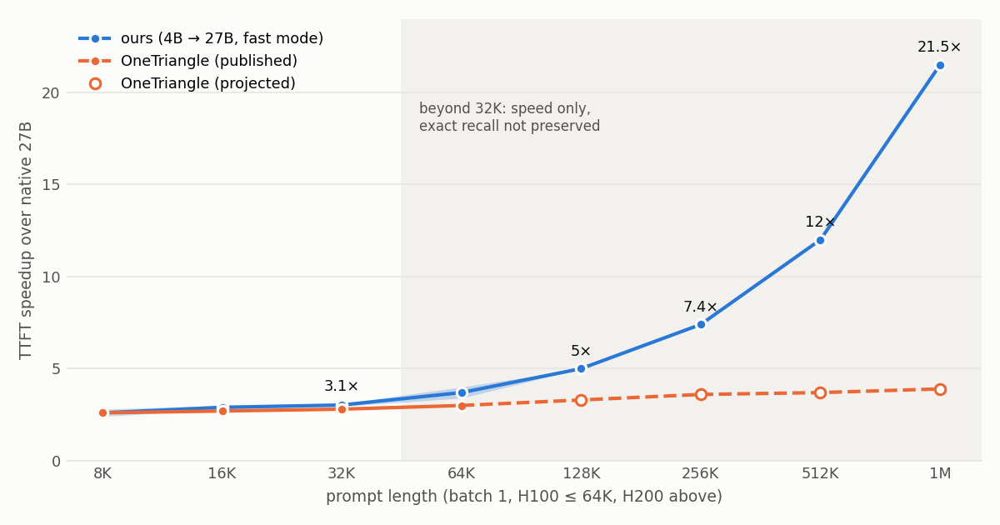

# Speed

Terms (fast mode, recall mode, graphed tail, maps) are defined in [method.md](method.md#glossary).

## Time to first token (batch 1)

Compare speedups, not absolute times: each side is measured against its own native baseline. Ours runs
FlashAttention-2 + fla kernels on one GPU; OneTriangle uses HF forwards on 2×H100 at 32K.

| prompt | native 27B | ours, fast mode | **speedup** | OneTriangle | GPU, source |
|---:|---:|---:|---:|---:|---|
| 8K | 0.90–0.93 s | 0.33–0.38 s | **2.4–2.8×** | 2.6× | H100, 6 runs [1] |
| 16K | 1.89–1.94 s | 0.63–0.68 s | **2.8–3.0×** | 2.7× | H100, 6 runs [1] |
| 32K | 4.14–4.25 s | 1.33–1.43 s | **2.95–3.1×** | 2.8× | H100, 6 runs [1] |
| 64K | 9.6–10.0 s | 2.4–3.0 s | **3.4–4.0×** | 3.0× | H100 / H200, 3 runs [2] |
| 128K | 25.5 s | 5.07 s | **5.0×** | 3.3× [3] | H200, median of 3 |
| 256K | 74.7 s | 10.2 s | **7.4×** | 3.6× [3] | H200, 1 run |
| 512K | 243.1 s | 20.3 s | **12.0×** | 3.7× [3] | H200, 1 run |
| **1M** | 873.2 s | 40.7 s | **21.5×** (21.1× [4]) | 3.9× [3] | H200, 1 run |

- **[1]** `ttft_h100_final_engine_two_runs.json`, `ttft_h100_8k-32k_final_engine.json` and the rep0 arms of
  `ttft_h100_recall_mode.json`; median of 5 per run. The six 8K runs: 2.44×, 2.62×, 2.66×, 2.68×, 2.69×, 2.76×, so
  8K is level with OneTriangle, not clearly ahead.
- **[2]** 64K does not fit next to the persistent graphed tail on an 80 GB H100 in the final build. The three 64K
  runs (`ttft_h100_8k-64k.json`, `ttft_h100_untuned_lengths_batches.json`, `ttft_h200_64k-128k_reps3.json`) used
  earlier builds: 3.4×, 4.0×, 3.75×.
- **[3]** OneTriangle's values above 64K are projections.
- **[4]** Earlier 1M run: native 833.2 s, ours 39.5 s (`ttft_h200_128k-1m_first_run.json`).

128K is from `ttft_h200_64k-128k_reps3.json`; 256K–1M from `ttft_h200_128k-1m.json` (its own 128K point was not
warmed up and is excluded). Both used an earlier engine build and the phase-2 map, with the 4B on an 8K sliding
window. **Beyond 32K these are speed results only**: exact recall degrades there (see
[benchmarks.md](benchmarks.md#beyond-32k)). All TTFT and TPOT runs use random token ids.

### Recall mode

4B → 27B (`ttft_h100_recall_mode.json`, H100, same native baseline):

| prompt | fast | +rep512 | +rep1024 | +rep2048 | +rep4096 |
|---:|---:|---:|---:|---:|---:|
| 8K | 2.62–2.68× | 1.72× | 1.59× | 1.37× | 0.97× |
| 16K | 2.83–2.86× | 2.19× | 2.06× | 1.81× | 1.37× |
| 32K | 2.95–2.98× | 2.55× | 2.40× | 2.17× | 1.74× |

2B → 27B (`ttft_repair-H100-20261118-130157` in the same file; `+rep1024` from `ttft_repair-H100-20261119-183932`
on plain random ids; the message-unit arms use random ids with a message-start token every 400 tokens):

| prompt | fast | +rep1024 | +rep2048 | +rep2048m | +rep3072m |
|---:|---:|---:|---:|---:|---:|
| 8K | 3.94× | 2.03× | 1.64× | 1.72× | 1.36× |
| 16K | 4.47× | 2.85× | 2.36× | 2.43× | 2.10× |
| 32K | 4.94× | 3.57× | 3.07× | 3.14× | 2.78× |

On the 4B pair, recall mode is **slower than OneTriangle's transfer** at every length. The timed region includes the
4B pass over the tail, the scoring pass and the 27B forward over the chosen tokens. One run (median of 5) per size.

### Other shapes

- **Short prompts:** under 4K the native tail is 512 tokens; prompts shorter than that run fully native (no speedup,
  native quality). OneTriangle publishes no TTFT below 8K.
- **Untuned lengths and batches** (`ttft_h100_untuned_lengths_batches.json`, `ttft_h100_final_engine_two_runs.json`):
  12K 2.6×, 24K 3.0×, 40K 3.5×; batch 2 at 16K 2.6×, at 32K 3.2×; batch 3 at 16K 3.2×. An earlier build: batch
  2/3/4 at 8K 3.0×/3.1×/3.2×, 50K 3.7×. Batch 8 at 8K did not fit in 80 GB for the native arm.

## Graphed tail with varying prompt lengths

The native tail runs as a CUDA graph captured per prompt length. The tables above reuse one length per row; in
serving, lengths vary and the graph is re-captured every request. τ2 telecom prompts (7.8K tokens, batch 1,
`tau2_replay.json`; graph off with `XKV_NO_GRAPH_TAIL=1`):

| | TTFT |
|---|---:|
| native 27B (two runs) | 1.41–1.46 s |
| fast mode, graphed tail on | 1.49 s |
| fast mode, graphed tail off | 0.93 s |

Graph off gives about 1.5× here, below the fixed-length 2.4×; this timing also includes tokenization and decoder
setup on both sides. Agent-setting timings are in [agents.md](agents.md#settings).

## Decode (TPOT)

The transferred cache has the native cache's exact shape, so decode costs the same as native at every batch size
measured (1, 2, 3, 4, 8, 12, 16, 32 at 2K; 1–12 at 32K; H200, CUDA graphs; `tpot_and_batch_sweeps.json`). Recall
mode writes into the same cache. Optionally the 4B drafts tokens for the 27B to verify (`keep_src=True`, which adds
the 4B's remaining layers to the prefill):

| context | batch | native TPOT | ours | ours + 4B drafting |
|---:|---:|---:|---:|---:|
| 2K | 1 | 23.6 ms | 23.5 ms | 17.4 ms |
| 32K | 1 | 24.1 ms | 24.1 ms | 22.2 ms |
| 2K | 2 | 24.5 ms | 24.5 ms | 25.2 ms |
| 2K | 32 | 33.4 ms | 33.4 ms | 60.5 ms |

Drafting helps only at batch 1. Verification is greedy, but batched bf16 numerics differ from step-by-step decoding:
on 6 prompts at batch 1, 4 produced a different continuation (`spec_decode_row_independence.json`), the same kind of
divergence plain decoding shows between batch sizes. OneTriangle publishes no TPOT for this pair.

## Serving under load

One H200, Poisson arrivals, prompts from {8K, 16K, 32K}, 256 output tokens, same FCFS scheduler for both arms, one
seed, 30 requests per rate.

**Current fidelity map, fast and recall mode** (`serve_h200_8k-32k_fid_recall.json`; 8 slots, all arms in one
container):

| | native 27B | fast mode | recall `+rep1024` |
|---|---:|---:|---:|
| max throughput (offline) | 0.30 req/s | 0.42 req/s (1.39×) | 0.38 req/s (1.26×) |
| best goodput, TTFT ≤ 5 s | 0.16 req/s | 0.30 req/s (1.9×) | 0.25 req/s (1.6×) |
| best goodput, TTFT ≤ 2 s | 0.09 req/s | 0.18 req/s (2.0×) | 0.12 req/s (1.3×) |
| TTFT p50 at 0.2 / 0.3 req/s | 2.1 / 5.4 s | 2.0 / 1.6 s | 1.8 / 2.6 s |

**Phase-2 map** (`serve_h200_8k-32k.json`, 8 slots; `serve_h200_8k-32k_slots16_chunked.json`, 16 slots with chunked
prefill):

| | native 27B (best of both schedulers) | ours (8 slots) | gain |
|---|---:|---:|---:|
| max throughput | 0.36 req/s | 0.45 req/s | 1.26× |
| best goodput, TTFT ≤ 5 s | 0.17 req/s | 0.37 req/s | 2.2× |
| best goodput, TTFT ≤ 2 s | 0.10 req/s | 0.20 req/s | 2.1× |
| TTFT p50 at 0.2 / 0.3 req/s | 2.0 / 5.2 s | 1.4 / 1.4 s | 1.5× / 3.6× |
| end-to-end p50 at 0.3 req/s | 27.4 s | 14.1 s | 1.9× |
| peak memory (ours incl. the 4B) | 101 GB | 96 GB | |

Throughput gains less than TTFT because the 256-token decode, identical for both arms, dominates once prefill is
cheap. With 30 requests per point, p99 is close to the maximum and the curves are noisy; the 1.9× vs 2.2× goodput
difference between the two runs is within that noise. The fidelity-map run's native arm peaks lower (0.30 vs
0.36 req/s) because it only used the 8-slot scheduler. The graphed tail was on in all serving runs.
